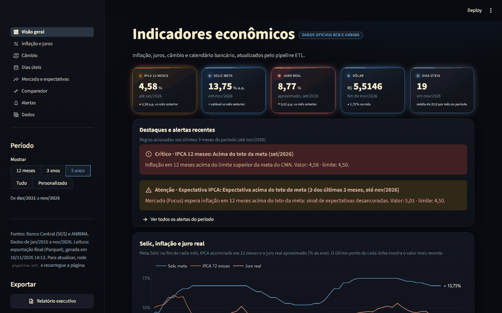
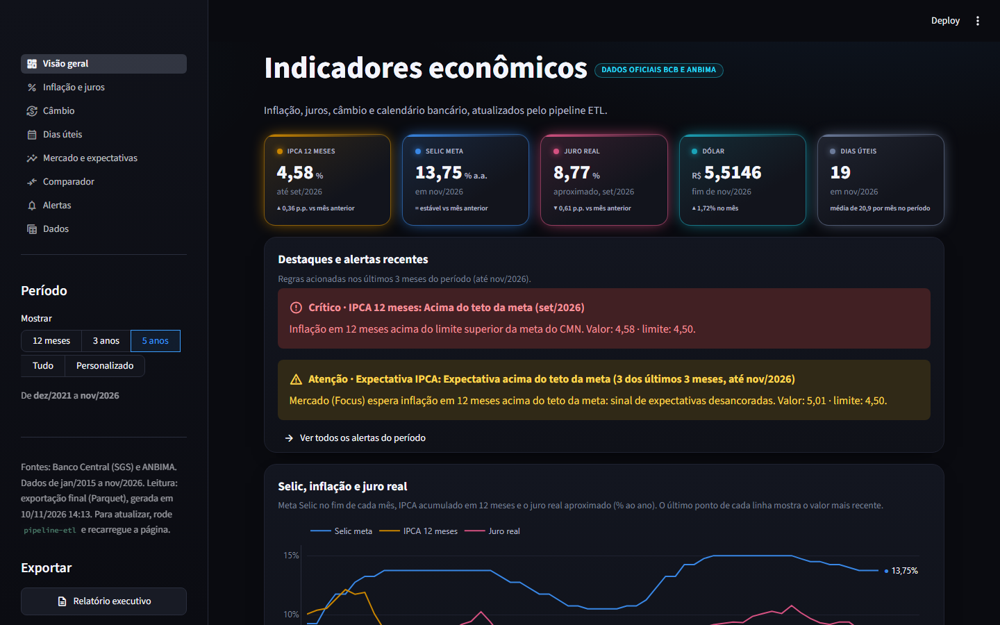
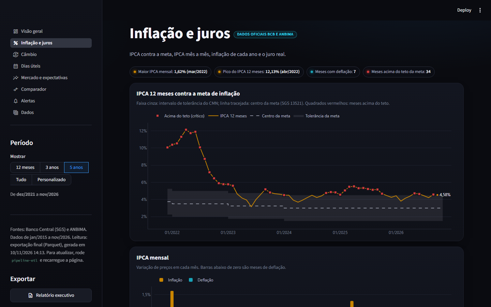
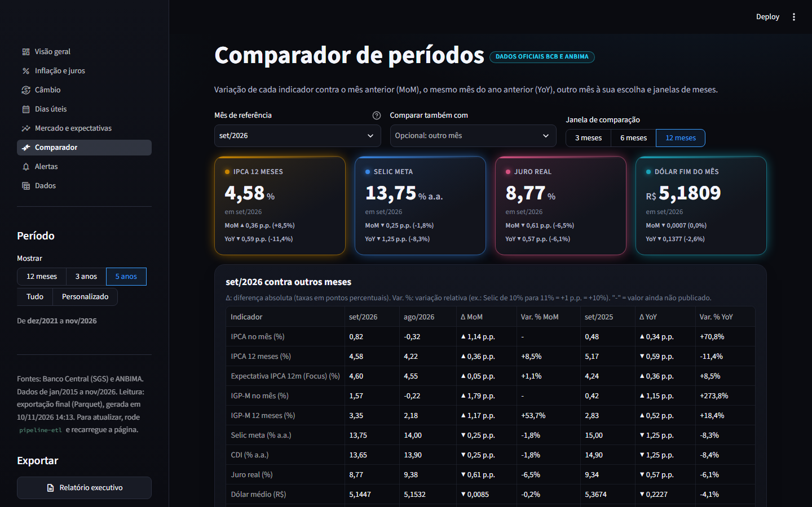
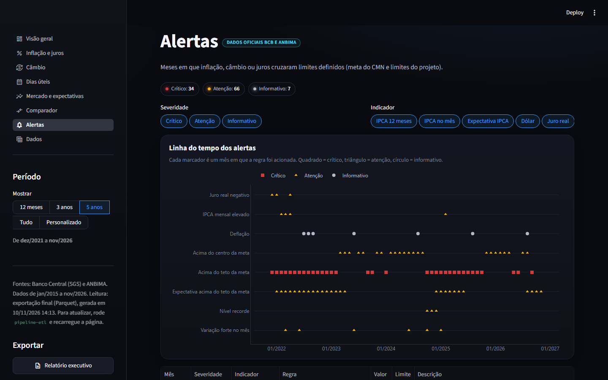
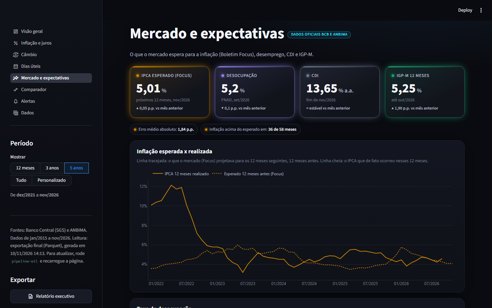
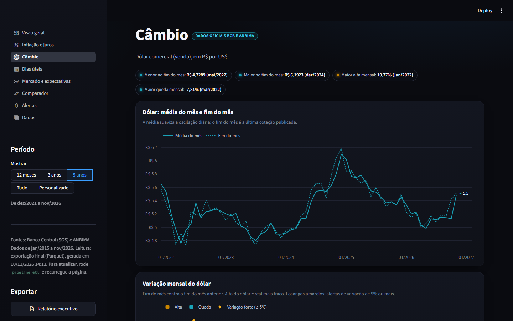

# Pipeline ETL de Indicadores Econômicos

[](https://github.com/molinatr19-star/projeto_pipeline_etl/actions/workflows/ci.yml)


Projeto de portfólio em engenharia de dados: um pipeline automatizado que extrai indicadores econômicos de **duas APIs públicas do Banco Central** e de **um arquivo da ANBIMA**, limpa e valida com Python, modela em SQL num warehouse DuckDB e entrega uma tabela mensal pronta para análise, com um **painel interativo** em Streamlit.



## O que o projeto mostra
- **Extração resiliente** de 3 fontes com formatos diferentes (JSON REST, OData, Excel), com novas tentativas, extração incremental e contorno documentado para um defeito de cache da API do BCB.
- **Camadas** raw → staging → warehouse → processed, com o raw nunca sobrescrito.
- **Modelagem dimensional em SQL** versionado: dimensões, dois fatos (valor realizado e expectativa de mercado) e uma mart mensal.
- **46 checagens de qualidade** em todas as camadas, incluindo o cruzamento entre fontes (nenhuma cotação do dólar em dia não útil) e a conferência do IPCA 12 meses calculado contra o publicado pelo BCB (diferença máxima de 0,01 p.p. em 130 meses).
- **Falha segura**: a carga do warehouse roda numa transação; se uma checagem falha, nada é publicado.
- **Painel** com 8 páginas: comparador MoM/YoY, alertas configuráveis (meta de inflação do CMN, choques cambiais) e relatório executivo para baixar.
- **Engenharia de software**: 89 testes, lint e formatação (ruff), verificação de tipos (ty), CI no GitHub Actions e execução agendada.

## Fontes de dados
| Fonte | Tipo | Conteúdo |
|-------|------|----------|
| SGS / Banco Central | API REST (JSON) | IPCA (433), Selic meta (432), dólar venda (1), meta de inflação (13521), IPCA 12 meses oficial (13522), IGP-M (189), CDI (4389), desocupação PNAD (24369) |
| Boletim Focus / Banco Central | API OData | Expectativa de mercado para o IPCA dos 12 meses seguintes (mediana) |
| ANBIMA | Arquivo Excel (.xls) | Feriados nacionais de 2001 a 2099 (calendário de dias úteis) |

## Arquitetura
```
API SGS (JSON)   API Focus (OData)   Planilha ANBIMA (.xls)
      \                 |                    /
       v                v                   v
   raw          cópia fiel da fonte, uma partição por dia (extração incremental)
   staging      tipos, limpeza, junção de partições e checagens (pandas -> Parquet)
   warehouse    DuckDB: dim_serie, dim_data, fct_indicador, fct_expectativa, mart mensal (SQL)
   processed    indicadores_mensal.parquet / .csv, relidos e conferidos
       |
       v
   painel       Streamlit (app.py)
```

## Painel
| Visão geral | Inflação e meta |
|---|---|
|  |  |
| **Comparador MoM / YoY** | **Alertas** |
|  |  |
| **Mercado e expectativas** | **Câmbio** |
|  |  |

Análise em formato de história: [notebooks/01_historia_dos_indicadores.ipynb](notebooks/01_historia_dos_indicadores.ipynb).

## Como rodar
```bash
python -m venv .venv
.venv\Scripts\activate                 # Windows (Linux/Mac: source .venv/bin/activate)
pip install -r requirements-dev.txt     # só para rodar: requirements.txt
pip install -e .

pipeline-etl                            # pipeline completo (incremental)
pipeline-etl --sem-extracao             # reprocessa sem acessar a internet
python -m streamlit run app.py          # painel
pytest                                  # testes
```
Etapas, nesta ordem: `extracao_bcb_sgs`, `extracao_anbima_feriados`, `extracao_bcb_focus`, `staging_bcb_sgs`, `staging_anbima_feriados`, `staging_bcb_focus`, `warehouse`, `exportacao` (rode só algumas com `pipeline-etl --etapas ...`).

### Execução agendada (Windows)
`powershell -ExecutionPolicy Bypass -File scripts\agendar_tarefa_windows.ps1` registra a tarefa `PipelineETL_Indicadores` (dias úteis, 19h, também na bateria). Saída em `logs\agendador.log`.

### Painel online (Streamlit Community Cloud)
O repositório já inclui a mart final (`data/processed/indicadores_mensal.parquet`). Para publicar:
1. Entre em [share.streamlit.io](https://share.streamlit.io) com a conta do GitHub.
2. **Create app** → repositório `molinatr19-star/projeto_pipeline_etl`, branch `main`, arquivo `app.py`.
3. Em *Advanced settings*, escolha Python 3.13 e confirme.

O painel online mostra os dados da última mart enviada ao GitHub. Para atualizar: rode `pipeline-etl`, faça commit do Parquet e envie.

## Estrutura
```
config/      pipeline.yaml (fontes, séries, limites dos alertas) e exemplo de .env
data/        raw -> staging -> processed
sql/         ddl, staging, marts e consultas de qualidade
src/         pacote pipeline_etl: extracao, transformacao, carga, qualidade, orquestracao, dashboard, utils
app.py       painel (páginas em paginas/, tema em .streamlit/config.toml)
notebooks/   análise em formato de história
scripts/     agendamento e capturas de tela do painel
docs/        arquitetura, decisões, dicionário de dados e imagens
tests/       testes automatizados
```
Detalhes em [docs/arquitetura.md](docs/arquitetura.md) e [docs/dicionario_dados.md](docs/dicionario_dados.md).

## Autoria
Molina, estudante de Análise e Desenvolvimento de Sistemas.
